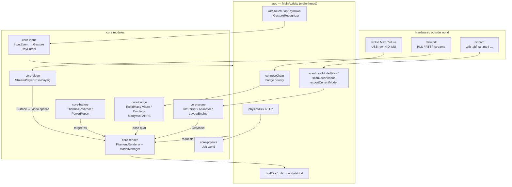
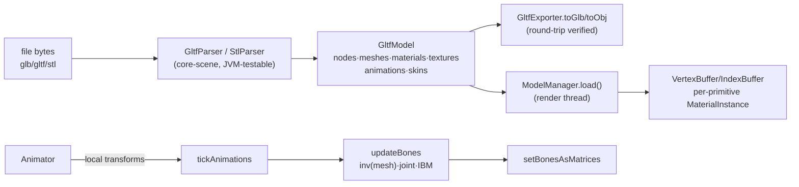
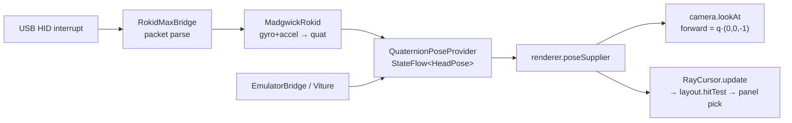

# Architektur

**Sprachen**: [English](ARCHITECTURE.md) · [Русский](ARCHITECTURE.ru.md) · Deutsch (diese Datei)

Wie die acht Module von `rokid-spatial-host` zur Laufzeit zusammenarbeiten.
Die API-Referenz Modul für Modul steht in `MODULES.md`; was die Demo
demonstrieren kann, steht in `CAPABILITIES.md`.

---

## 1. Das große Bild



Zwei harte Grenzen halten das Design zusammen:

* **`core-scene` ist reines Kotlin** — Parsing, Animationsmathematik und
  Panel-Geometrie laufen als JVM-Unit-Tests in CI. Kein `android.*`-Import
  darf in dieses Modul gelangen.
* **Der Renderer ist ein Diener mit Briefkasten.** Der UI-Thread berührt
  nie Filament-Objekte; er postet *Anfragen*, die der Render-Thread oben
  in seiner Frame-Schleife konsumiert (§3).

---

## 2. Threads

| Thread | Besitzer | Arbeit | Taktung |
|---|---|---|---|
| **Main** | Android + `MainActivity` | Lebenszyklus, Touch-/Tastenevents, HUD-Text, Dateiscans (IO im Thread über Coroutines), `physicsTick` | HUD 1 Hz; Physik fest 60 Hz (`FIXED_PHYSICS_DT = 1/60`) |
| **Render** | `FilamentRenderer.renderLoop` | konsumiert alle Pending-Kanäle, Animation + Skinning, Kamera aus `poseSupplier`, Filament-Frame | getaktet auf `targetFps` (Standard 90, temperaturgeregelt) |
| **Coroutines (Dispatchers.IO)** | diverse | Dateiscans, GLB-Parsing, Export, USB `connect()` | eventgetrieben |
| **ExoPlayer internal** | `core-video` | Demux/Decode → `Surface` | eventgetrieben |

Regeln:

* **Der Render-Thread besitzt alles Filament.** `ModelManager`-Zustand,
  `SceneState`, Materialien, Texturen — nur innerhalb von `renderLoop()`
  veränderbar. Die App fragt; sie greft nie ein.
* **Der Haupt-Thread besitzt den App-Zustand**: `sceneModels`,
  `selectedModelId`, `videoStatus`, `physicsActive`.
* Daten, die Threads überqueren, sind **unveränderlich**: Float-Arrays,
  Value-Objects, kleine Op-Datensätze. Keine Locks werden zwischen
  Modulen geteilt.
* `onSceneReady`- und Video-Sphären-Callbacks werden mit
  `Handler(Looper.getMainLooper())` in den Haupt-Thread marshalled — der
  Renderer führt nie App-Code im eigenen Thread aus.

---

## 3. Die Render-Schleife (ein Frame)

`FilamentRenderer.renderLoop()` — ein langlebiger try/finally, der die
Szene einmal aufbaut und dann schleift:

```
── scene build (once per surface lifetime) ──────────────────────────
  Engine.create(OPENGL) → Renderer, Scene, View, Camera (70° VFOV,
  near 0.05, far 500, exposure f/16-sunny, post-processing OFF)
  MaterialFactory: colorUnlit + panelUi + lit (PBR) — runtime filamat
  Meshes: backdrop sphere r=30, quad
  IblBuilder → indirectLight + Skybox (else flat-color sphere fallback)
  directional key light (110 klux, castShadows) aligned with IBL sun
  buildShadowFloor() — lit slab at y = -1 (matches physics floor)
  SceneState(...) → onSceneReady posted to main thread
────────────────────────────────────────────────────────────────────
── per frame ────────────────────────────────────────────────────────
  1. wait for surface + non-zero size (else sleep 16 ms)
  2. create SwapChain / set viewport+projection on first frame or resize
  3. applyPendingPanels()        ← panel specs from UI
     applyPendingPanelUi()       ← rasterized widget bitmaps
     applyFocus()                ← focused/selected panel highlight
  4. pendingModelOps (FIFO)      ← Load / Transform / Remove /
                                    AnimToggle / AnimClip
  5. ModelManager.tickAnimations(now)   → node local transforms
     ModelManager.updateBones()         → GPU skinning matrices
     animationStatus = hudStatus()
  6. pendingColor / pendingVideo → detach/attach video sphere
  7. poseSupplier() → camera lookAt (head quaternion → forward/up)
  8. beginFrame → render → endFrame
  9. once per second: measuredFps + "diag:" log line
 10. sleep to pace against targetFps
────────────────────────────────────────────────────────────────────
── teardown (surface destroyed / stopThread) ────────────────────────
  destroySceneState → ModelManager.shutdown(), textures, materials,
  IBL, swap chain, engine — everything; a rebuild starts from scratch
────────────────────────────────────────────────────────────────────
```

### Pending-Kanäle (der Briefkasten)

Alle sind `@Volatile`-Felder auf `FilamentRenderer`, von jedem Thread
geschrieben und **einmal** oben in der Frame-Schleife konsumiert:

| Feld | Typ | Producer → Consumer |
|---|---|---|
| `pendingPanels` | `List<PanelSpec>?` | App `setPanels()` → Render |
| `pendingPanelUi` | `List<PanelUiUpdate>?` | App `updatePanelUi()` → Render |
| `focusedId` | `String?` | App `setFocusedPanel()` → Render |
| `pendingModelOps` | `List<ModelOp>?` | App `requestModel/…` → `ModelManager` (FIFO bewahrt die Reihenfolge) |
| `pendingVideo` | `((Surface) -> Unit)?` | App `requestVideoSphere()` → Render hängt die Sphäre an und postet die Surface dann zurück in den Haupt-Thread |
| `pendingColor` | `(() -> Unit)?` | App `requestColorSphere()` → Render trennt zuerst ab (damit schnelle Stop→Start-Paare in Reihenfolge aufgelöst werden) |
| `onSceneReady` | `(() -> Unit)?` | Render → Haupt-Thread, nach jedem Szenen-(Wieder)aufbau |

Warum eine *Liste* für Model-Ops: Ein Klon + eine Transformation + ein
Entfernen, die im selben Schub ausgelöst werden, müssen in Auslöse-
Reihenfolge angewendet werden; ein einzelner Slot würde Zwischenstände
verwerfen.

### Pfad des Szenen-Wiederaufbaus

Der erste Start öffnet den systemweiten All-Files-Einstellungs-Bildschirm,
der die **Surface zerstört** → `surfaceDestroyed` → `stopThread()` →
vollständiger Teardown. Beim Zurückkehren wird die Szene von Grund auf
gebaut, und die einmaligen Kanäle waren bereits konsumiert.
`onSceneReady → reapplySceneContent()` pusht alles Einmalige erneut:
Panels, UI-Texturen, jedes Modell in `sceneModels`, und — entscheidend —
bereitet den Video-Player **erneut vor** (ein bloßes `setSurface` lässt
ExoPlayer in `ERROR_CODE_DECODING_FAILED`). Der erste Aufbau wird
übersprungen (`firstSceneApply`), weil die eigenen Queues von onCreate
noch anstehen.

---

## 4. Asset-Pipeline (glTF → Pixel)



Pipeline-Stufen und wo sie verifiziert werden:

1. **Parsen** — `GltfParser.parse` (GLB/JSON, externer `.bin`-Resolver),
   `StlParser.parse`. Abgesichert durch `GltfRoundTripTest`,
   `StlParserTest`, `AnimationTest`, `SkinTest` (insgesamt 17 JVM-Tests,
   laufen in der CI).
2. **Laden** — `ModelManager.load(id, …)` im Render-Thread: baut Vertex-
   und Index-Buffer, Material-Instanzen pro Primitive (PBR-Faktoren +
   Texturen mit dem sRGB-/linear-Split), Knoten → Filament-Transforma-
   tionshierarchie, optional `Builder.skinning(≤255)` mit Bone-Attribut-
   Slots. Texturen werden einmal pro `GltfModel` dekodiert und über Klone
   hinweg geteilt (`modelTexCache`).
3. **Animieren** — `tickAnimations` führt jeden `Animator` voran (dt auf
   250 ms begrenzt) und schreibt die lokalen Knoten-Transformationen;
   `updateBones` berechnet dann
   `bone[j] = inverse(meshWorld) · jointWorld[j] · IBM[j]`
   (die Formel aus gltfio) und ruft `setBonesAsMatrices` auf.
4. **Export** — `GltfExporter.toGlb` gibt Geometrie, Materialien, Bilder
   (byte-identisch), Knotenhierarchie, Animationen und Skins erneut aus;
   `MainActivity.exportCurrentModel` parst das Ergebnis im Speicher neu
   und loggt `ROUND-TRIP OK`.

Koordinatenkonventionen, die sich einmal lohnen zu nennen: Matrizen sind
**spaltenweise** (glTF und Filament sind sich einig); Quaternions sind
`float[4] = (x,y,z,w)`; Welteinheiten sind Meter; die Physik-Boden-
oberfläche ist `y = -1`.

---

## 5. Pose-Pipeline (IMU → Kamera)



* `connectChain()` versucht Bridges in Prioritätsreihenfolge: **Rokid Max
  → Viture → Emulator-Fallback**; der erste `Connected` gewinnt und wird
  als `activeBridge` gemerkt.
* Mit echten Brillen besitzt die IMU die Orientierung; ein Maus-Drag
  steuert dann einen darüberliegenden **manuellen Look-Offset**
  (`useLookOffset`). Der Emulator-Pfad brennt den Drag stattdessen in
  seine eigene Orientierung ein.
* 3DoF bedeutet nur Rotation — `RayCursor` behandelt das Auge als
  Sitzungsursprung; einen translationsbedingten Parallaxe gibt es
  bewusst nicht.

---

## 6. Input-Pipeline

```
MotionEvent / KeyEvent (MainActivity.wireTouch / onKeyDown)
    → InputEvent (Drag / Tap / DoubleTap / DragEnd / Back / Key)   [core-input]
    → GestureRecognizer.onEvent → Gesture?                         [core-input]
    → MainActivity.handleGesture / feature keys                    [:app]
        SELECT     → selectAtCrosshair: model pick (nearest hitBox)
                      first, else panel hitTest
        RECENTER   → reset session frame
        SWIPE_*    → cycleFocus(+/-) across panels
        TOGGLE_HUD → hudVisible
        feature keys V/N/M/P/E/B/DEL/A/G handled BEFORE the
        recognizer — they return early in onKeyDown
```

Zwei eingebaute Fallstricke in `GestureRecognizer`: Ein Drag darf nicht
als Tap klassifiziert werden (Flagge `dragging`), und ein beendeter Drag
darf den nächsten Klick nicht verschlingen (`DragEnd` setzt den Zustand
zurück). Mausrad-Events umgehen Gesten vollständig: Mausrad = ausgewähltes
Modell skalieren, sonst nächste Videoquelle.

---

## 7. Physik-Schleife

```
main thread, 60 Hz (physicsTick):
    physics.step(1/60)
    for obj in sceneModels: obj.pos/rot ← bodyPosition/bodyRotation(obj.id)
                             renderer.setModelTransform(obj.id, …)
```

* Körper sind **pro Objekt-id** (`bodyIds`, `bodyMass`-Maps) — dieselben
  ids schlüsseln die Render-Transformationen, sodass mehrere Objekte
  stapeln und kollidieren.
* `togglePhysics()` AN: eine dynamische Box pro Objekt aus ihrer
  skalierten AABB + ein statischer Boden (`addFloor`, idempotent). AUS:
  Posen werden im Landezustand eingefroren und die Körper entfernt.
* Greifen = `grab(id)` + `dragTo(Fadenkreuz-Punkt)` bei jeder Bewegung;
  die Feder (`KP=88.8, KD=17.0`, Kraft begrenzt auf ≈10 g) folgt dem
  Ziel; Loslassen behält die Geschwindigkeit → Werfen.
* Solange die Physik aktiv ist, verschieben Mausrad/Drag Modelle
  **nicht** (Wächter lesen `physicsActive`) — die Simulation besitzt die
  Transformationen.

---

## 8. Video-Pipeline

```
PUBLIC_SOURCES / local file → StreamPlayer.prepare(url, lowLatency)
    → requestVideoSphere { surface → player.setSurface(surface) }
    → renderer attaches textured sphere (r=30) + hides non-persistent panels
onFirstFrame → videoStatus = "streaming" → HUD + panel UI redraw
stopVideo → setSurface(null) FIRST → requestColorSphere → detach
```

* Die Sphäre verbirgt alle Panels außer den `persistent`-en (das
  `video-deck`), sodass das Deck während der Wiedergabe erreichbar bleibt.
* Panel-Widgets (PLAY/SRC/LOOP/SEEK) werden von `PanelUiDrawer` in die
  Panel-Textur rasterisiert; Klicks werden in `handleWidget` per UV
  hit-getestet.
* Quellen wechseln: `N`/Mausrad schaltet durch `PUBLIC_SOURCES` +
  gescannte lokale Dateien; jede ExoPlayer-URL (z. B. `rtsp://`) kann
  angehängt werden.

---

## 9. Thread- & Lebenszyklus-Invarianten (Zusammenfassung)

1. Filament-Objekte leben und sterben im Render-Thread; die App sendet
   nur Anfragen.
2. Jede einmalige Anfrage hat einen Re-Push-Pfad über `onSceneReady` (die
   Szene *wird* beim ersten Start einmal neu aufgebaut).
3. Jedes `create*` im Renderer hat ein passendes destroy in
   `destroySceneState` — keine Lecks über Surface-Wechsel hinweg.
4. Payloads über Threads hinweg sind unveränderliche Wertedaten; kein
   Modul teilt ein veränderliches Objekt mit dem Thread eines anderen
   Moduls.
5. `core-scene` bleibt Android-frei, damit die CI die Asset-Pipeline ohne
   Gerät testen kann.
6. Das Frame-Taking liest `ThermalGovernor.frameIntervalNanos` indirekt
   über `targetFps` — thermisches Throttling darf die FPS nur senken,
   nie crashen oder die Schleife zum Stillstand bringen.
