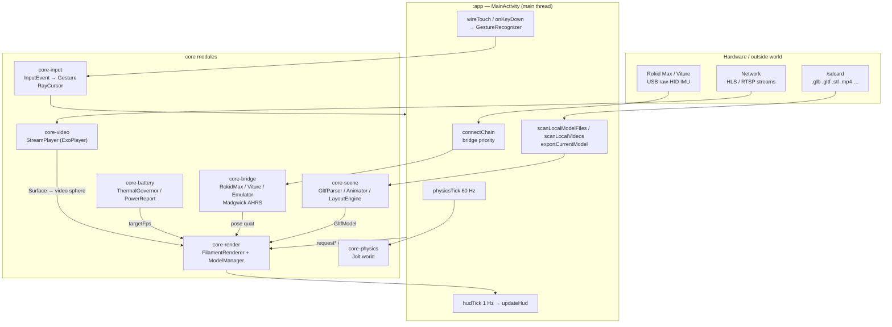
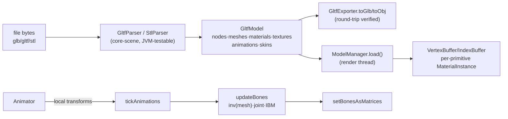
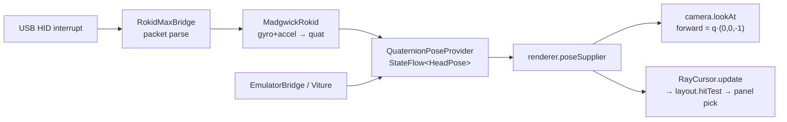

# Architecture

**Languages**: [Русский](ARCHITECTURE.ru.md) · [Deutsch](ARCHITECTURE.de.md) · English (this file)

How the eight modules of `rokid-spatial-host` cooperate at runtime.
Module-by-module API reference lives in `MODULES.md`; what the demo can
demonstrate lives in `CAPABILITIES.md`.

---

## 1. The big picture



Two hard boundaries hold the design together:

* **`core-scene` is pure Kotlin** — parsing, animation math and panel
  geometry run as JVM unit tests in CI. No `android.*` import may enter
  that module.
* **The renderer is a servant with a mailbox.** The UI thread never
  touches Filament objects; it posts *requests* that the render thread
  consumes at the top of its frame loop (§3).

---

## 2. Threads

| Thread | Owner | Work | Cadence |
|---|---|---|---|
| **Main** | Android + `MainActivity` | lifecycle, touch/key events, HUD text, file scans (IO off-thread via coroutines), `physicsTick` | HUD 1 Hz; physics 60 Hz fixed (`FIXED_PHYSICS_DT = 1/60`) |
| **Render** | `FilamentRenderer.renderLoop` | consumes all pending channels, animation + skinning, camera from `poseSupplier`, Filament frame | paced to `targetFps` (default 90, thermal-governed) |
| **Coroutines (Dispatchers.IO)** | various | file scans, GLB parsing, export, USB `connect()` | event-driven |
| **ExoPlayer internal** | `core-video` | demux/decode → `Surface` | event-driven |

Rules:

* **Render thread owns everything Filament.** `ModelManager` state,
  `SceneState`, materials, textures — mutated only inside
  `renderLoop()`. The app asks; it never reaches in.
* **Main thread owns app state**: `sceneModels`, `selectedModelId`,
  `videoStatus`, `physicsActive`.
* Data crossing threads is **immutable**: arrays of floats, value
  objects, small op records. No locks are shared between modules.
* `onSceneReady` and video-sphere callbacks are marshalled to the main
  thread with `Handler(Looper.getMainLooper())` — the renderer never
  runs app code on its own thread.

---

## 3. The render loop (single frame)

`FilamentRenderer.renderLoop()` — one long-lived try/finally that
builds the scene once and then loops:

```
── scene build (once per surface lifetime) ──────────────────────────
  Engine.create(OPENGL) → Renderer, Scene, View, Camera (70° VFOV,
  near 0.05, far 500, exposure f/16-sunny, post-processing OFF)
  MaterialFactory: colorUnlit + panelUi + lit (PBR) — runtime filamat
  Meshes: backdrop sphere r=30, quad
  IblBuilder → indirectLight + Skybox (else flat-color sphere fallback)
  directional key light (110 klux, castShadows) aligned with IBL sun
  buildShadowFloor() — lit slab at y = -1 (matches physics floor)
  SceneState(...) → onSceneReady posted to main thread
────────────────────────────────────────────────────────────────────
── per frame ────────────────────────────────────────────────────────
  1. wait for surface + non-zero size (else sleep 16 ms)
  2. create SwapChain / set viewport+projection on first frame or resize
  3. applyPendingPanels()        ← panel specs from UI
     applyPendingPanelUi()       ← rasterized widget bitmaps
     applyFocus()                ← focused/selected panel highlight
  4. pendingModelOps (FIFO)      ← Load / Transform / Remove /
                                    AnimToggle / AnimClip
  5. ModelManager.tickAnimations(now)   → node local transforms
     ModelManager.updateBones()         → GPU skinning matrices
     animationStatus = hudStatus()
  6. pendingColor / pendingVideo → detach/attach video sphere
  7. poseSupplier() → camera lookAt (head quaternion → forward/up)
  8. beginFrame → render → endFrame
  9. once per second: measuredFps + "diag:" log line
 10. sleep to pace against targetFps
────────────────────────────────────────────────────────────────────
── teardown (surface destroyed / stopThread) ────────────────────────
  destroySceneState → ModelManager.shutdown(), textures, materials,
  IBL, swap chain, engine — everything; a rebuild starts from scratch
────────────────────────────────────────────────────────────────────
```

### Pending channels (the mailbox)

All are `@Volatile` fields on `FilamentRenderer`, written by any thread,
consumed **once** at the top of the frame loop:

| Field | Type | Producer → consumer |
|---|---|---|
| `pendingPanels` | `List<PanelSpec>?` | app `setPanels()` → render |
| `pendingPanelUi` | `List<PanelUiUpdate>?` | app `updatePanelUi()` → render |
| `focusedId` | `String?` | app `setFocusedPanel()` → render |
| `pendingModelOps` | `List<ModelOp>?` | app `requestModel/…` → `ModelManager` (FIFO preserves order) |
| `pendingVideo` | `((Surface) -> Unit)?` | app `requestVideoSphere()` → render attaches sphere, then posts the Surface back to main |
| `pendingColor` | `(() -> Unit)?` | app `requestColorSphere()` → render detaches first (so rapid stop→start pairs resolve in order) |
| `onSceneReady` | `(() -> Unit)?` | render → main, after every scene (re)build |

Why a *list* for model ops: a clone + a transform + a remove issued in
the same burst must apply in issue order; a single slot would drop
intermediate states.

### Scene rebuild path

The first run opens the system all-files settings screen, which
**destroys the surface** → `surfaceDestroyed` → `stopThread()` → full
teardown. On return the scene is built from scratch, and the one-shot
channels were already consumed. `onSceneReady → reapplySceneContent()`
re-pushes everything one-shot: panels, UI textures, every model in
`sceneModels`, and — critically — **re-prepares** the video player (a
bare `setSurface` leaves ExoPlayer in `ERROR_CODE_DECODING_FAILED`).
First build is skipped (`firstSceneApply`) because onCreate's own
queues are still pending.

---

## 4. Asset pipeline (glTF → pixels)



Pipeline stages and where they are verified:

1. **Parse** — `GltfParser.parse` (GLB/JSON, external `.bin` resolver),
   `StlParser.parse`. Guarded by `GltfRoundTripTest`, `StlParserTest`,
   `AnimationTest`, `SkinTest` (17 JVM tests total, run in CI).
2. **Load** — `ModelManager.load(id, …)` on the render thread: builds
   vertex/index buffers, per-primitive material instances (PBR factors +
   textures with the sRGB/linear split), node → Filament transform
   hierarchy, optional `Builder.skinning(≤255)` with bone attribute
   slots. Textures are decoded once per `GltfModel` and shared across
   clones (`modelTexCache`).
3. **Animate** — `tickAnimations` advances every `Animator` (dt clamped
   to 250 ms) and writes node local transforms; `updateBones` then
   computes `bone[j] = inverse(meshWorld) · jointWorld[j] · IBM[j]`
   (gltfio's formula) and calls `setBonesAsMatrices`.
4. **Export** — `GltfExporter.toGlb` re-emits geometry, materials,
   images (verbatim bytes), node hierarchy, animations and skins;
   `MainActivity.exportCurrentModel` re-parses the result in memory and
   logs `ROUND-TRIP OK`.

Coordinate conventions worth stating once: matrices are **column-major**
(glTF and Filament agree); quaternions are `float[4] = (x,y,z,w)`; world
units are meters; the physics floor top is `y = -1`.

---

## 5. Pose pipeline (IMU → camera)



* `connectChain()` tries bridges in priority order: **Rokid Max →
  Viture → emulator fallback**; the first `Connected` wins and is
  remembered as `activeBridge`.
* With real glasses the IMU owns orientation; a mouse drag then steers a
  **manual look offset** layered on top (`useLookOffset`). The emulator
  path bakes the drag into its own orientation instead.
* 3DoF means rotation only — `RayCursor` treats the eye as the session
  origin; there is no translational parallax by design.

---

## 6. Input pipeline

```
MotionEvent / KeyEvent (MainActivity.wireTouch / onKeyDown)
    → InputEvent (Drag / Tap / DoubleTap / DragEnd / Back / Key)   [core-input]
    → GestureRecognizer.onEvent → Gesture?                         [core-input]
    → MainActivity.handleGesture / feature keys                    [:app]
        SELECT     → selectAtCrosshair: model pick (nearest hitBox)
                      first, else panel hitTest
        RECENTER   → reset session frame
        SWIPE_*    → cycleFocus(+/-) across panels
        TOGGLE_HUD → hudVisible
        feature keys V/N/M/P/E/B/DEL/A/G handled BEFORE the
        recognizer — they return early in onKeyDown
```

Two fixed traps encoded in `GestureRecognizer`: a drag must not be
classified as a tap (`dragging` flag), and a finished drag must not
swallow the next click (`DragEnd` resets state). Wheel events bypass
gestures entirely: wheel = scale selected model, else next video source.

---

## 7. Physics loop

```
main thread, 60 Hz (physicsTick):
    physics.step(1/60)
    for obj in sceneModels: obj.pos/rot ← bodyPosition/bodyRotation(obj.id)
                             renderer.setModelTransform(obj.id, …)
```

* Bodies are **per object id** (`bodyIds`, `bodyMass` maps) — the same
  ids key render transforms, so several objects stack and collide.
* `togglePhysics()` ON: one dynamic box per object from its scaled AABB
  + one static floor (`addFloor`, idempotent). OFF: poses are frozen at
  the landing state and bodies are removed.
* Grab = `grab(id)` + `dragTo(crosshair point)` each move; the spring
  (`KP=88.8, KD=17.0`, force clamped ≈10 g) tracks the target; release
  keeps velocity → throw.
* While physics is active, wheel/drag do **not** reposition models
  (guards read `physicsActive`) — the simulation owns the transforms.

---

## 8. Video pipeline

```
PUBLIC_SOURCES / local file → StreamPlayer.prepare(url, lowLatency)
    → requestVideoSphere { surface → player.setSurface(surface) }
    → renderer attaches textured sphere (r=30) + hides non-persistent panels
onFirstFrame → videoStatus = "streaming" → HUD + panel UI redraw
stopVideo → setSurface(null) FIRST → requestColorSphere → detach
```

* Sphere hides all panels except `persistent` ones (the `video-deck`),
  so the deck stays reachable while watching.
* Panel widgets (PLAY/SRC/LOOP/SEEK) are rasterized by
  `PanelUiDrawer` into the panel texture; clicks are UV-hit-tested in
  `handleWidget`.
* Sources cycle: `N`/wheel steps through `PUBLIC_SOURCES` + scanned
  local files; any ExoPlayer URL (e.g. `rtsp://`) can be appended.

---

## 9. Threading & lifetime invariants (summary)

1. Filament objects live and die on the render thread; the app only
   sends requests.
2. Every one-shot request has a re-push path via `onSceneReady` (the
   scene *will* be rebuilt once on first run).
3. Every `create*` in the renderer has a matching destroy in
   `destroySceneState` — no leaks across surface churn.
4. Cross-thread payloads are immutable value data; no module shares a
   mutable object with another module's thread.
5. `core-scene` stays Android-free so CI can test the asset pipeline
   without a device.
6. Frame pacing reads `ThermalGovernor.frameIntervalNanos` indirectly
   through `targetFps` — thermal throttling must degrade FPS only, never
   crash or stall the loop.
