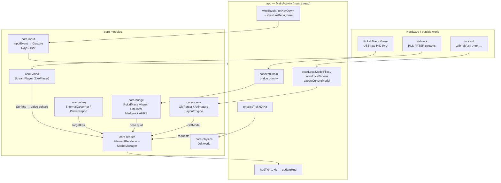
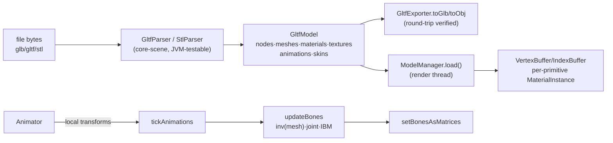
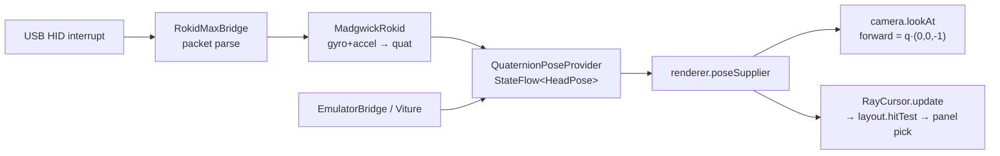

# Архитектура

**Языки**: [English](ARCHITECTURE.md) · [Deutsch](ARCHITECTURE.de.md) · Русский (этот файл)

Как восемь модулей `rokid-spatial-host` взаимодействуют во время работы.
Справочник API по модулям находится в `MODULES.md`; то, что может
демонстрировать демо, — в `CAPABILITIES.md`.

---

## 1. Общая картина



Две жёсткие границы держат дизайн вместе:

* **`core-scene` — чистый Kotlin** — разбор, математика анимаций и
  геометрия панелей выполняются как JVM unit-тесты в CI. Никакой импорт
  `android.*` не может попасть в этот модуль.
* **Рендерер — слуга с почтовым ящиком.** Поток UI никогда не трогает
  объекты Filament; он отправляет *запросы*, которые поток рендера
  потребляет в начале своего цикла кадров (§3).

---

## 2. Потоки

| Поток | Владелец | Работа | Темп |
|---|---|---|---|
| **Главный** | Android + `MainActivity` | жизненный цикл, события касаний/клавиш, текст HUD, сканирование файлов (IO в отдельном потоке через корутины), `physicsTick` | HUD 1 Гц; физика 60 Гц фиксированно (`FIXED_PHYSICS_DT = 1/60`) |
| **Рендера** | `FilamentRenderer.renderLoop` | потребляет все каналы ожидания, анимация + скиннинг, камера из `poseSupplier`, кадр Filament | такт по `targetFps` (по умолчанию 90, управляется термостатом) |
| **Корутины (Dispatchers.IO)** | разные | сканирование файлов, разбор GLB, экспорт, USB `connect()` | по событиям |
| **Внутренний поток ExoPlayer** | `core-video` | демультиплексирование/декодирование → `Surface` | по событиям |

Правила:

* **Поток рендера владеет всем, что относится к Filament.** Состояние
  `ModelManager`, `SceneState`, материалы, текстуры — изменяются только
  внутри `renderLoop()`. Приложение спрашивает; оно никогда не лезет
  внутрь.
* **Главный поток владеет состоянием приложения**: `sceneModels`,
  `selectedModelId`, `videoStatus`, `physicsActive`.
* Данные, пересекающие потоки, **неизменяемы**: массивы float,
  объекты-значения, маленькие записи операций. Между модулями не
  разделяется ни одна блокировка.
* `onSceneReady` и колбэки видеосферы доставляются в главный поток через
  `Handler(Looper.getMainLooper())` — рендерер никогда не выполняет код
  приложения в собственном потоке.

---

## 3. Цикл рендера (один кадр)

`FilamentRenderer.renderLoop()` — один длинный try/finally, который
один раз собирает сцену и затем крутится в цикле:

```
── scene build (once per surface lifetime) ──────────────────────────
  Engine.create(OPENGL) → Renderer, Scene, View, Camera (70° VFOV,
  near 0.05, far 500, exposure f/16-sunny, post-processing OFF)
  MaterialFactory: colorUnlit + panelUi + lit (PBR) — runtime filamat
  Meshes: backdrop sphere r=30, quad
  IblBuilder → indirectLight + Skybox (else flat-color sphere fallback)
  directional key light (110 klux, castShadows) aligned with IBL sun
  buildShadowFloor() — lit slab at y = -1 (matches physics floor)
  SceneState(...) → onSceneReady posted to main thread
────────────────────────────────────────────────────────────────────
── per frame ────────────────────────────────────────────────────────
  1. wait for surface + non-zero size (else sleep 16 ms)
  2. create SwapChain / set viewport+projection on first frame or resize
  3. applyPendingPanels()        ← panel specs from UI
     applyPendingPanelUi()       ← rasterized widget bitmaps
     applyFocus()                ← focused/selected panel highlight
  4. pendingModelOps (FIFO)      ← Load / Transform / Remove /
                                    AnimToggle / AnimClip
  5. ModelManager.tickAnimations(now)   → node local transforms
     ModelManager.updateBones()         → GPU skinning matrices
     animationStatus = hudStatus()
  6. pendingColor / pendingVideo → detach/attach video sphere
  7. poseSupplier() → camera lookAt (head quaternion → forward/up)
  8. beginFrame → render → endFrame
  9. once per second: measuredFps + "diag:" log line
 10. sleep to pace against targetFps
────────────────────────────────────────────────────────────────────
── teardown (surface destroyed / stopThread) ────────────────────────
  destroySceneState → ModelManager.shutdown(), textures, materials,
  IBL, swap chain, engine — everything; a rebuild starts from scratch
────────────────────────────────────────────────────────────────────
```

### Каналы ожидания (почтовый ящик)

Все они — поля `@Volatile` на `FilamentRenderer`, записываемые любым
потоком и потребляемые **один раз** в начале цикла кадров:

| Поле | Тип | Производитель → потребитель |
|---|---|---|
| `pendingPanels` | `List<PanelSpec>?` | приложение `setPanels()` → рендер |
| `pendingPanelUi` | `List<PanelUiUpdate>?` | приложение `updatePanelUi()` → рендер |
| `focusedId` | `String?` | приложение `setFocusedPanel()` → рендер |
| `pendingModelOps` | `List<ModelOp>?` | приложение `requestModel/…` → `ModelManager` (FIFO сохраняет порядок) |
| `pendingVideo` | `((Surface) -> Unit)?` | приложение `requestVideoSphere()` → рендер присоединяет сферу, затем возвращает Surface в главный поток |
| `pendingColor` | `(() -> Unit)?` | приложение `requestColorSphere()` → рендер сначала отсоединяет (чтобы быстрые пары stop→start разрешались по порядку) |
| `onSceneReady` | `(() -> Unit)?` | рендер → главный, после каждой (пере)сборки сцены |

Почему для операций с моделями используется *список*: клон + преобразование
+ удаление, выпущенные одним пакетом, должны примениться в порядке
выпуска; одна ячейка потеряла бы промежуточные состояния.

### Путь пересборки сцены

При первом запуске открывается системный экран настроек доступа ко всем
файлам, который **уничтожает surface** → `surfaceDestroyed` →
`stopThread()` → полный демонтаж. По возвращении сцена собирается с
нуля, а одноразовые каналы уже потреблены.
`onSceneReady → reapplySceneContent()` повторно отправляет всё
одноразовое: панели, текстуры UI, каждую модель из `sceneModels` и —
что важно — **снова готовит** видеоплеер (один только `setSurface`
оставляет ExoPlayer в `ERROR_CODE_DECODING_FAILED`). Первая сборка
пропускается (`firstSceneApply`), потому что очереди самого onCreate
ещё ожидают.

---

## 4. Конвейер ассетов (glTF → пиксели)



Стадии конвейера и места, где они проверяются:

1. **Разбор** — `GltfParser.parse` (GLB/JSON, внешний resolver для
   `.bin`), `StlParser.parse`. Защищено тестами `GltfRoundTripTest`,
   `StlParserTest`, `AnimationTest`, `SkinTest` (всего 17 JVM-тестов,
   выполняются в CI).
2. **Загрузка** — `ModelManager.load(id, …)` в потоке рендера: строит
   вершинные/индексные буферы, экземпляры материалов на примитив (PBR-
   коэффициенты + текстуры с разделением sRGB/linear), иерархию
   преобразований узел → Filament, опционально `Builder.skinning(≤255)`
   со слотами атрибутов костей. Текстуры декодируются один раз на
   `GltfModel` и разделяются между клонами (`modelTexCache`).
3. **Анимация** — `tickAnimations` продвигает каждый `Animator`
   (dt ограничен 250 мс) и записывает локальные преобразования узлов;
   затем `updateBones` вычисляет
   `bone[j] = inverse(meshWorld) · jointWorld[j] · IBM[j]` (формула
   из gltfio) и вызывает `setBonesAsMatrices`.
4. **Экспорт** — `GltfExporter.toGlb` заново порождает геометрию,
   материалы, изображения (байты дословно), иерархию узлов, анимации и
   скины; `MainActivity.exportCurrentModel` повторно разбирает результат
   в памяти и пишет в лог `ROUND-TRIP OK`.

Стоит один раз оговорить соглашения о координатах: матрицы в порядке
столбцов (column-major) — glTF и Filament согласны; кватернионы —
`float[4] = (x,y,z,w)`; единицы мира — метры; верх пола физики —
`y = -1`.

---

## 5. Конвейер позы (IMU → камера)



* `connectChain()` перебирает мосты в порядке приоритета: **Rokid Max →
  Viture → запасной эмулятор**; первый `Connected` побеждает и
  запоминается как `activeBridge`.
* С настоящими очками ориентацию задаёт IMU; перетаскивание мыши затем
  управляет **ручным смещением взгляда**, наложенным поверх
  (`useLookOffset`). Путь эмулятора вместо этого запекает перетаскивание
  в собственную ориентацию.
* 3DoF означает только вращение — `RayCursor` считает глаз началом
  координат сессии; трансляционного параллакса по замыслу нет.

---

## 6. Конвейер ввода

```
MotionEvent / KeyEvent (MainActivity.wireTouch / onKeyDown)
    → InputEvent (Drag / Tap / DoubleTap / DragEnd / Back / Key)   [core-input]
    → GestureRecognizer.onEvent → Gesture?                         [core-input]
    → MainActivity.handleGesture / feature keys                    [:app]
        SELECT     → selectAtCrosshair: model pick (nearest hitBox)
                      first, else panel hitTest
        RECENTER   → reset session frame
        SWIPE_*    → cycleFocus(+/-) across panels
        TOGGLE_HUD → hudVisible
        feature keys V/N/M/P/E/B/DEL/A/G handled BEFORE the
        recognizer — they return early in onKeyDown
```

Две закодированные в `GestureRecognizer` ловушки: перетаскивание не
должно классифицироваться как тап (флаг `dragging`), а завершённое
перетаскивание не должно поглощать следующий клик (`DragEnd` сбрасывает
состояние). События колеса в обход жестам: колесо = масштаб выбранной
модели, иначе — следующий источник видео.

---

## 7. Физический цикл

```
main thread, 60 Hz (physicsTick):
    physics.step(1/60)
    for obj in sceneModels: obj.pos/rot ← bodyPosition/bodyRotation(obj.id)
                             renderer.setModelTransform(obj.id, …)
```

* Тела привязаны **к id объекта** (карты `bodyIds`, `bodyMass`) — теми же
  ключами задаются преобразования рендера, поэтому несколько объектов
  складываются и сталкиваются.
* `togglePhysics()` ВКЛ: по одному динамическому боксу на объект из его
  масштабированного AABB + один статический пол (`addFloor`,
  идемпотентно). ВЫКЛ: позы замораживаются в состоянии приземления, тела
  удаляются.
* Хват = `grab(id)` + `dragTo(точка прицела)` на каждом движении; пружина
  (`KP=88.8, KD=17.0`, сила ограничена ≈10 g) следует за целью;
  отпускание сохраняет скорость → бросок.
* Пока физика активна, колесо/перетаскивание **не** перемещают модели
  (проверки читают `physicsActive`) — преобразованиями владеет симуляция.

---

## 8. Видеоконвейер

```
PUBLIC_SOURCES / local file → StreamPlayer.prepare(url, lowLatency)
    → requestVideoSphere { surface → player.setSurface(surface) }
    → renderer attaches textured sphere (r=30) + hides non-persistent panels
onFirstFrame → videoStatus = "streaming" → HUD + panel UI redraw
stopVideo → setSurface(null) FIRST → requestColorSphere → detach
```

* Сфера скрывает все панели, кроме `persistent` (это `video-deck`),
  поэтому дека остаётся доступной во время просмотра.
* Виджеты панели (PLAY/SRC/LOOP/SEEK) растеризуются `PanelUiDrawer` в
  текстуру панели; клики проверяются по UV в `handleWidget`.
* Источники перебираются: `N`/колесо шагает по `PUBLIC_SOURCES` +
  просканированным локальным файлам; любой URL ExoPlayer (например,
  `rtsp://`) можно добавить.

---

## 9. Инварианты потоков и жизненного цикла (кратко)

1. Объекты Filament живут и умирают в потоке рендера; приложение только
   отправляет запросы.
2. У каждого одноразового запроса есть путь повторной отправки через
   `onSceneReady` (сцена *будет* пересобрана один раз при первом
   запуске).
3. У каждого `create*` в рендерере есть соответствующее уничтожение в
   `destroySceneState` — без утечек при смене surface.
4. Межпоточные полезные нагрузки — неизменяемые данные-значения; ни один
   модуль не разделяет изменяемый объект с потоком другого модуля.
5. `core-scene` остаётся свободным от Android, чтобы CI мог тестировать
   конвейер ассетов без устройства.
6. Темп кадров косвенно читает `ThermalGovernor.frameIntervalNanos`
   через `targetFps` — троттлинг по температуре должен только деградировать
   FPS, но не ронять и не останавливать цикл.
